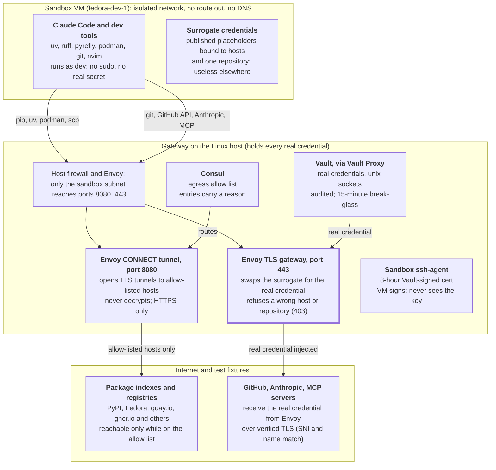

# Security Controls for AI-Augmented Software Development

## Purpose and scope

An AI coding agent can work on private code without ever holding a real credential or reaching a
site that no one approved. This document explains, at a high level, the controls that make that true
and how people should work inside them.

It covers the ai-sandbox lab (`labs/fedora44min-x86_64-dev-ws` in the [local-dev-workspaces-sandbox
repository](https://github.com/infrashift/local-dev-workspaces-sandbox)): Claude Code and a Python
toolchain run in an isolated Fedora 44 virtual machine, and a zero-trust gateway on the Linux host
holds every real credential. The design assumes **the agent is compromised**: through a mistake, a
malicious dependency or a prompt injection in code, issues or web content it reads.

> **Warning:** The controls below are built and verified on a **Pop!_OS or Ubuntu 24.04 LTS** host
> only. The host bootstrap and gateway automation use `apt` and Debian/Ubuntu package names, paths,
> users and AppArmor. On any other Linux distribution, the host automation probably needs changes
> first, and the controls must be verified again there. See
> [Supported hosts](README.md#supported-hosts).

It is written for developers who use the agent, the operator who runs the host and the gateway, and
reviewers who need to judge the risk. The wiki and the code hold the detail; [References](#references)
at the end points to them.

## Threats we design against

The adversary is the sandbox VM and everything running in it. Machines beside the host (the LAN,
test VMs, containers) are adversaries too. Root on the host is trusted: it holds the Vault unseal
key, which is the lab's deliberate trade-off.

| Threat | Example | Main controls |
| --- | --- | --- |
| Credential theft | The agent reads a token from its environment and posts it somewhere | Surrogate credentials; real secrets only in Vault on the host |
| Credential replay | A leaked surrogate is used against another repository or service | Each surrogate is bound to its hosts and one repository; the gateway refuses it elsewhere |
| SSH key theft or misuse | The agent copies an SSH key and uses it later, from anywhere | The key stays in an ssh-agent on the host; the VM only borrows signatures through a forwarded socket, under an 8-hour certificate for one login |
| Data exfiltration | Code is sent to a paste site or an attacker's server | Default-deny egress allow list; no route or DNS out of the VM |
| Destructive change | The agent force-pushes, deletes a branch or opens issues | Read-only PATs and read-only MCP tools |
| Supply-chain compromise | A tampered tool binary or package | Pinned versions, SHA-256 and signature checks, hash-locked Python requirements |
| Lateral movement | The VM reaches Vault, Consul or SSH on the host, or a neighbour reaches the gateway | Isolated network, host firewall, unix sockets, source-filtered listeners |
| Insider misuse | An operator reads a real credential without cause | The operator token cannot read secrets; break-glass is short-lived and audited |

## Architecture at a glance

The sandbox VM has two ways out, both through Envoy on the host: a tunnel for approved package sites,
and a TLS gateway that adds the real credential.

Package traffic stays encrypted end to end through the tunnel. Credentialed traffic ends at the TLS
gateway, which checks the surrogate, injects the real credential and opens a new verified TLS
connection.

## Security controls by layer

Nine layers each hold on their own. A failure in one, such as a firewall table that is gone, is
still caught by another, such as Envoy's source filter.

| Layer | Control | What it gives |
| --- | --- | --- |
| Network isolation | The VM sits on an isolated libvirt network with no NAT, no route off the host and no DNS. A host firewall lets it reach only the gateway's two ports, and Envoy accepts connections only from the sandbox subnet. | The agent has no way out except the gateway, even as root in the VM. Neighbours cannot use the gateway. |
| Credentials | The VM holds **surrogates**: published, worthless placeholders for each GitHub PAT and the Anthropic key. Envoy swaps a surrogate for the real credential, which it reads from Vault, on the way out. | No real secret exists in the VM to steal. A real token smuggled in is refused, because only surrogates have records. |
| Anti-replay | Each surrogate is bound to its target hosts and, for GitHub, to one repository. Paths are normalized before the check, and each host is rate-limited. The filter fails closed. | A surrogate works only where it was meant to. A path trick or a flood does not get past it. |
| Egress | A default-deny allow list in Consul, seeded from a reviewed catalog of package and registry hosts (PyPI, Fedora, container registries and others), HTTPS only. Operator additions carry a reason and take effect in seconds. | The agent can install packages but cannot send data to a site of its choice. |
| Least privilege for agent tools | One fine-grained PAT per repository, Contents and Metadata read-only. The GitHub MCP servers run in read-only mode. | The agent can read but not push, open issues or merge. |
| SSH credentials | A dedicated ssh-agent on the host holds one egress key, separate from the operator's own agent. Vault's SSH CA signs it for one login (`scp-target`) for 8 hours, and Vault audits every signing. Only the dev ssh session forwards the agent; the admin session forwards nothing. Each SSH target must also be on the allow list. | No SSH key exists in the VM. The VM can ask for a signature while a dev session is open, but cannot copy the key or use it after the certificate expires. |
| Operator access and audit | Vault and Consul listen only on unix sockets. The daily operator token sees metadata but cannot read a secret. Break-glass gives a 15-minute, non-renewable, response-wrapped token that records who and why. Every Vault request is in a fail-closed audit log. | Reading a real credential is rare, deliberate and traceable. |
| PKI and TLS | A private gateway CA (P-384, name-constrained to the gateway's host names, every IP excluded) signs Envoy's certificate. Envoy verifies every upstream by SNI and name. | A leaked CA key could not impersonate any other site to the VM. |
| Supply chain and configuration | Every tool is pinned and verified by SHA-256, and Envoy and Terraform by GPG signature too. Python requirements are hash-locked. Ansible roles follow a contract: no defaults, a dry run before every change, and asserts on their result. | What runs is what was reviewed, and drift shows up as a pending change. |

## Safe use for developers

The controls limit what the agent can do; these practices limit what it should do. Treat everything
the agent produces as a proposal from an untrusted contributor.

1. **Work only in the sandbox.** Run Claude Code on `fedora-dev-1`, never on your laptop or the
   host. The host holds the real credentials.
2. **Never bring a real secret into the VM.** No personal tokens, SSH keys or cloud credentials in
   files, environment variables or prompts. If a tool needs access, ask the operator for a gateway
   route and a surrogate.
3. **Review every change before it leaves the sandbox.** Read the diff, run `ruff`, `pyrefly` and
   the tests yourself, and push from your own reviewed workflow. The sandbox cannot push, on purpose.
4. **Approve tool calls one at a time.** Read each command and file edit Claude Code proposes. Deny
   shell commands that fetch scripts, change credentials, or reach for hosts or paths outside the
   task.
5. **Treat content the agent reads as untrusted input.** Issues, READMEs, web pages and dependency
   code can carry prompt injection. Be wary when the agent's plan changes after it reads one.
6. **Ask for a new site; never work around a refusal.** A `403` from the tunnel means the site is
   not approved. Ask the operator, with a reason. Do not tunnel, encode or relay through an allowed
   host.
7. **Prefer pinned, known dependencies.** Add packages with `uv add`, review `uv.lock` changes, and
   scan images with syft and grype before you ship them.
8. **Report anything odd.** A refused request you did not expect, a surrogate that stops working or
   an agent that tries to reach new hosts is a signal. Tell the operator.

## Operator responsibilities

The operator owns the host, the gateway and every real credential, and makes changes only through
the `make` targets, which validate input and keep tokens out of logs.

| Task | How | Safety rule |
| --- | --- | --- |
| Allow a site | `make -f lab-gateway.mk allow HOST=<host:port> REASON="why"` | Allow a specific vendor host, never a shared cloud wildcard. Give a reason. Remove it with `deny` when the task ends. |
| Review the allow list | `make -f lab-gateway.mk allowlist` | Review the operator entries regularly. Each shows its reason. |
| Load or rotate a credential | `make -f lab-gateway.mk secrets NAME=<name>` | One fine-grained, read-only PAT per repository. Rotate before expiry and at once after a suspected leak. Revoke the old PAT on GitHub. |
| Renew the SCP certificate | `make -f lab-gateway.mk agent-cert` | It lasts 8 hours. Renew it only when SCP is needed. |
| Read a real credential | `make -f lab-gateway.mk break-glass REASON="why"` | Emergencies only. The token lasts 15 minutes and every read is audited. |
| Review access | `sudo` on `/var/log/vault/audit.log` | Check every break-glass use against its stated reason. |
| Keep the lab current | Change pins in the playbooks, run the dry run, then the verify suites | Never edit Vault, Consul or the hosts by hand; the next run reverts drift. |

## Assurance: how the controls are checked

The controls are checked three ways: read-only automated suites, manual acceptance stories, and
lint. On 2026-10-27 the automated suites passed in full (gateway 280, sandbox 140, python-stack 61
tests).

| Check | Run with | Covers |
| --- | --- | --- |
| Gateway suite | `make -f lab-gateway-verify.mk` | Vault policies and audit, Consul, Envoy listeners and admin view, the firewall, the PKI and its name constraints, the allow list, the ssh-agent |
| Sandbox suite | `make -f lab-provision-verify.mk STACK=sandbox` | Isolation, no real secret on the VM, each surrogate end to end, anti-replay across hosts and repositories, path tricks, rate limits, Claude Code's own TLS to the gateway |
| UAT stories | [`uat/`](uat/README.md) | 40 manual scenarios by persona: daily development, egress requests, rotation, break-glass and audit |
| Lint and contracts | `make -f lab-provision.mk lint` | Shell, YAML and Ansible lint, the role contract, the UAT spec schema, Python |

Every change goes through a dry run first, and a second run must find nothing to change. A test that
passes with a probe can still miss the real client: the UAT pass found that Claude Code rejected a
certificate chain that curl and Python accepted. A test now runs Claude Code itself.

## Known limitations and residual risks

The controls stop credential theft and unapproved egress. They do not make the agent's output
correct or safe, and some trust remains by design.

- **Root on the host can read every credential.** The unseal key and root token sit root-only on the
  host so that Vault unseals after a restart. Protect the host as you would a password vault.
- **Allowed hosts are a channel out.** The agent can still send data to any site on the allow list,
  such as a package index or a container registry, and anything it may read through the gateway, such
  as the private repositories, is readable by design. Keep the list short and review it.
- **Read access is still access.** The agent can read every file in the repositories its PATs cover
  and pass that content to the model provider. Choose those repositories with that in mind.
- **A forwarded agent signs for whoever asks.** While a dev session is open, any process in the VM
  can ask the sandbox agent to sign, and so log in as `scp-target` to any allow-listed server that
  trusts Vault's SSH CA. The 8-hour certificate, the single login and the allow list bound this.
  Close dev sessions you don't need, and renew the certificate only when SCP is needed.
- **Generated code is untrusted.** Nothing here reviews logic, licences or secrets that the agent
  writes into code. Human review and CI stay required.
- **Prompt injection is contained, not prevented.** The controls limit what an injected instruction
  can reach; they do not stop the agent from following one.
- **Tested on one host family.** Only Pop!_OS and Ubuntu 24.04 LTS hosts are tested. A port to
  another distribution (SELinux instead of AppArmor, other package names, firmware paths and QEMU
  user) must pass the gateway and sandbox suites before you rely on these controls there.
- **One sandbox, one identity.** All sandboxes would share the same surrogates. Per-sandbox identity
  is needed before several agents share one gateway.
- **Open issues (2026-10-27):** grype cannot download its database without an operator entry; Docker
  Hub image pulls can fail on a CDN host off the list; the `allow` target accepts a gateway host
  (inert, but misleading); admin's tmux pane shows an error. None of them weakens isolation or
  credentials.

## References

All paths are in the
[local-dev-workspaces-sandbox repository](https://github.com/infrashift/local-dev-workspaces-sandbox).
The wiki pages live under `.okfw/`.

| Topic | Where |
| --- | --- |
| Operator procedures | [README.md](README.md) |
| The gateway, part by part | [Zero-Trust Surrogate Gateway](../../.okfw/concepts/zero-trust-surrogate-gateway--01a17f01fd4c.md) |
| Surrogates and who reads what | [Surrogate Credential Model](../../.okfw/concepts/surrogate-credential-model--01a17ecc92e2.md) |
| Network isolation | [Isolated Sandbox Network](../../.okfw/concepts/isolated-sandbox-network--01a17e9c824e.md) |
| Threat model and the unix-socket decision | [Vault and Consul Host Trust](../../.okfw/concepts/vault-and-consul-host-trust--01a17ebdba27.md) |
| Operator tools and break-glass | [Operator Interfaces](../../.okfw/concepts/operator-interfaces--01a17ebdba31.md) |
| Egress catalog | [ansible/vars/egress-baseline.yml](ansible/vars/egress-baseline.yml) |
| Routes and surrogates | [ansible/vars/gateway.yml](ansible/vars/gateway.yml) |
| UAT stories | [uat/README.md](uat/README.md) |
| Open issues | [.okfw/issues/](../../.okfw/issues/) |
